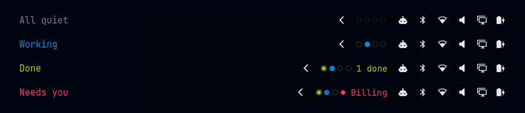
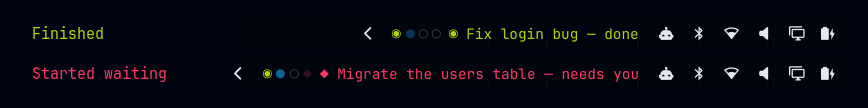
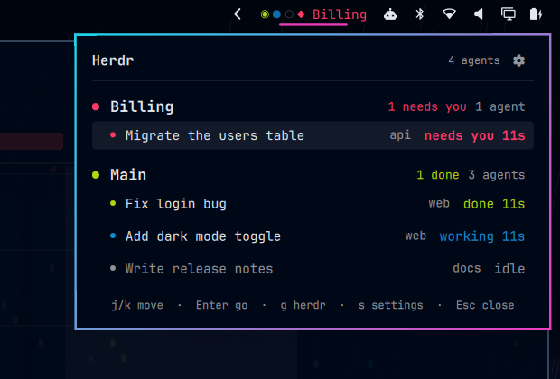
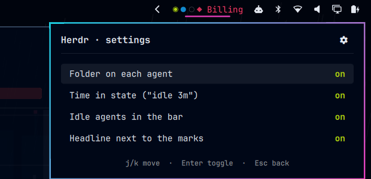

<p align="center">
  
</p>

# omaherdrbar

Your [herdr](https://herdr.dev) agents, in the Omarchy bar. Work anywhere and
still know the moment an agent needs you, finishes, or is still going.

## Install

Requires Omarchy (with its Quickshell bar) and herdr.

```sh
omarchy plugin add https://github.com/minerado/omaherdrbar.git --enable
```

For [instant updates](#instant-updates), also run:

```sh
herdr plugin link ~/.config/omarchy/plugins/ramon.omaherdrbar --enabled
```

## Features

### See who needs you at a glance

Each agent gets one mark in the bar, coloured from your theme: red `◆` blinks
when it needs you, green `◉` means it finished, blue `●` breathes while it
works. When something needs you, the bar names it. When nothing does, the
widget fades back.



### Find out the moment something changes

When an agent finishes or starts waiting on you, the bar says so for a few
seconds. It stays quiet while you're already looking at herdr.



### Jump straight to the agent

Click the widget for every agent, grouped by herdr workspace. The groups that
need you most come first, and each agent shows its folder and how long it's
been in that state. Press `Enter` on an agent to land in its pane.



`j`/`k` move · `Enter` go to agent · `g` open herdr · `s` settings · `Esc` close.
Right-click the widget to jump to herdr.

### Make it yours

Press `s` (or click the cog) to choose what's shown: folders, time in state,
idle agents in the bar, and the headline. Changes apply instantly and are saved
to your Omarchy config.



### Instant updates

omaherdrbar is also a herdr plugin. Once it's linked (see [Install](#install)),
herdr tells the bar about every change as it happens, so it updates in well
under a second instead of on the next poll.

## Configuration

<details>
<summary>All settings</summary>

Settings live in the widget's entry in `~/.config/omarchy/shell.json`. Set them
with `omarchy bar set ramon.omaherdrbar <key> <value> --json`.

| Key | Default | What it does |
|---|---|---|
| `workspace` | `9` | Hyprland workspace herdr lives on (right-click, `g` and `Enter` jump there) |
| `herdrPath` | `~/.local/bin/herdr`, then `herdr` on PATH | The herdr binary |
| `pollMs` | `2000` | Check interval while the panel is closed (1s while open) |
| `tickerMs` | `6000` | How long a bar message stays |
| `showFolder` | `true` | Folder on each agent row |
| `showDuration` | `true` | Time in state ("idle 3m") |
| `showIdleInBar` | `true` | Idle agents' marks in the bar. When off and all agents are idle, one faint mark stays |
| `showHeadline` | `true` | Text next to the marks. Bar messages still show when off |

IPC: `quickshell ipc -p /usr/share/omarchy/shell call ramon.omaherdrbar toggle`
(also `open` / `close`).

</details>

## Development

<details>
<summary>Layout, local install, tests</summary>

| File | Role |
|---|---|
| `Model.js` | Pure logic: ranking, groups, headline, events, durations |
| `Omaherdrbar.qml` | Bar strip and panel (`StatusMark.qml`, `AgentRow.qml` are pieces) |
| `Shared.js` | State shared by the per-monitor copies of the widget |
| `herdr-plugin.toml`, `herdr-hook` | The herdr side of instant updates |
| `tests/model.test.mjs` | `node tests/model.test.mjs` |

Run from a checkout:

```sh
ln -s ~/code/omaherdrbar ~/.config/omarchy/plugins/ramon.omaherdrbar
omarchy-shell shell rescanPlugins
omarchy plugin enable ramon.omaherdrbar
herdr plugin link ~/code/omaherdrbar --enabled
```

Edits don't hot-reload through the symlink; run `omarchy restart shell`. Check
hook runs with `herdr plugin log list`.

`~/.local/bin/herdr` is preferred over PATH because an older packaged
`/usr/bin/herdr` can win there and fails against a newer running server.

</details>

## License

MIT
