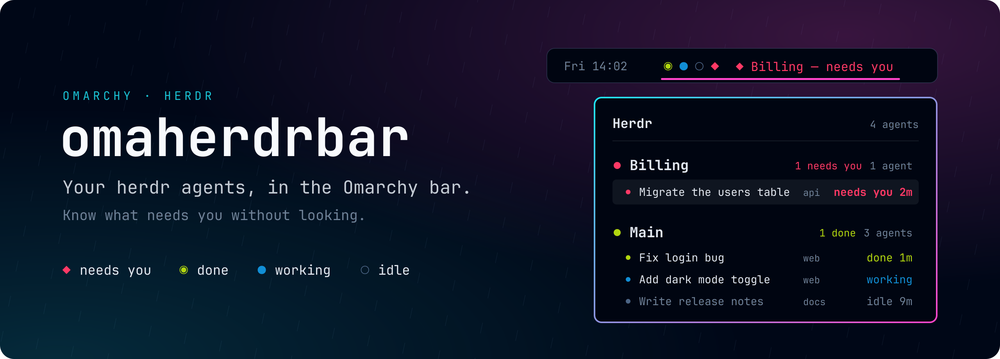

  

# omaherdrbar

Omarchy shell bar widget that answers one question while you're not looking at
[herdr](https://herdr.dev): **does anything need me, and where?**

## Bar

One mark per agent, in a stable order, coloured from the theme palette
(`red` / `green` / `blue` in `colors.toml`), plus a headline when there's
something to act on:

| Mark | Meaning | Headline |
|---|---|---|
| `◆` red, blinks | needs you (blocked) | workspace or session name, or `N need you` |
| `◉` green | done, not looked at yet (herdr's `done`) | `N done` |
| `●` blue, breathes | working | — |
| `○` faint | idle | — |

The widget dims when nothing needs you. Hover for a per-workspace summary.

**Ticker:** when an agent finishes or starts needing you, the headline shows
what happened for 6s (`◆ Migrate the users table to… — needs you`), then
returns to normal. It stays quiet while you're on the herdr workspace or have
the panel open.

- Left-click: open the panel.
- Right-click: jump to the herdr workspace.

## Panel

Agents grouped by herdr workspace, most urgent group first. Each group shows its
most urgent fact ("1 needs you") and size; each row shows the session title,
its folder (hidden when the title already is the folder) and status, with how
long it has been in that state (once the widget has seen the state start).

Keys: `j`/`k` move · `Enter` go to agent (`herdr agent focus` + jump to the
herdr workspace) · `g` open herdr · `s` settings · `Esc` close. Click a row to
go to it.

**Settings view** (`s` or the cog in the header): toggle what's shown with
`j`/`k` + `Enter`, `Esc` back. Each toggle is saved with
`omarchy bar set ramon.omaherdrbar <key> <true|false> --json`.

| Key | Shows |
|---|---|
| `showFolder` | the folder on each agent row |
| `showDuration` | time in state ("idle 3m") |
| `showIdleInBar` | idle agents' marks in the bar (off: only active ones, or one faint mark when all are idle) |
| `showHeadline` | the text next to the marks (the ticker still shows) |

IPC: `quickshell ipc -p /usr/share/omarchy/shell call ramon.omaherdrbar toggle`.

## Install

Needs Omarchy (Quickshell bar) and [herdr](https://herdr.dev).

    omarchy plugin add https://github.com/minerado/omaherdrbar.git --enable

Optional, for instant updates (see below):

    herdr plugin link ~/.config/omarchy/plugins/ramon.omaherdrbar --enabled

## Settings (shell.json widget entry)

- `workspace` (default 9): Hyprland workspace herdr lives on (right-click, `g`
  and `Enter` jump there).
- `herdrPath` (default `~/.local/bin/herdr`, then `herdr` on PATH): the herdr binary.
- `pollMs` (default 2000): snapshot interval while the panel is closed (1s while open).
- `tickerMs` (default 6000): how long a ticker message stays.

## Layout

- `Model.js`: pure logic (ranking, groups, headline, durations, theme parsing).
- `Omaherdrbar.qml`: bar strip + panel. `StatusMark.qml`, `AgentRow.qml`: pieces.
- `Shared.js`: state shared by the per-monitor copies (which panel is open, poke fan-out).
- `herdr-plugin.toml`, `herdr-hook`: the herdr side of instant updates.
- `tests/model.test.mjs`: `node tests/model.test.mjs`.

## Development

    ln -s ~/code/omaherdrbar ~/.config/omarchy/plugins/ramon.omaherdrbar
    omarchy-shell shell rescanPlugins
    omarchy plugin enable ramon.omaherdrbar

Edits through the symlink don't hot-reload; run `omarchy restart shell`.

## Instant updates (herdr hook)

The repo is also a herdr plugin (`herdr-plugin.toml`). herdr runs
`herdr-hook` on `pane.agent_status_changed`, `pane.agent_detected` and
`pane.closed`; the hook calls `omarchy-shell -q ramon.omaherdrbar-hook refresh`,
and every bar copy polls at once, so a change shows in well under a second
instead of on the next poll. Polling stays on as the fallback.

    herdr plugin link <plugin dir> --enabled     # once
    herdr plugin unlink ramon.omaherdrbar        # to remove
    herdr plugin log list                        # see hook runs

## Notes

`~/.local/bin/herdr` (where herdr's installer puts it) is preferred over PATH
because an older packaged `/usr/bin/herdr` can win on the shell's PATH and fails
against a newer running server.

## License

MIT
